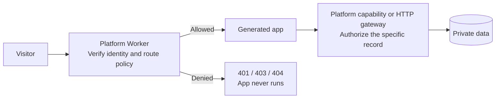
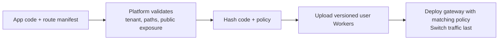
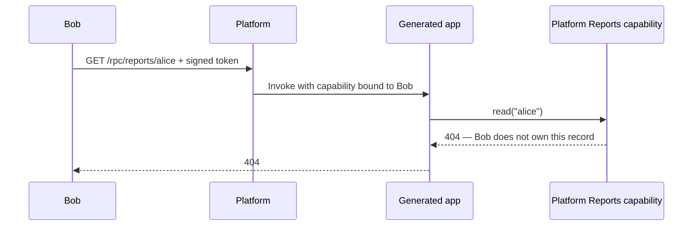

# Auth for generated apps

An AI can add `/reports` tomorrow. Your platform still owns who can read a report today.

Six small examples run on **both Workers for Platforms and Dynamic Workers**. Each uses the same signed tokens, policies, app code, and assertions.



**Authentication:** who is calling? **Authorization:** may they enter this route or read this record?

## Run it

Requires Node.js 24.22+ in the 24.x release line, or 26.12+, and npm.

```sh
npm ci
npm run setup
npm run dev
```

In a second terminal:

```sh
npm test
```

This runs Dynamic Workers locally. To test real dispatch namespaces, deploy:

```sh
npx cf auth login
npm run deploy

# Use the URL printed by cf deploy.
BASE_URL=https://YOUR-WORKER.workers.dev RUNTIMES=dynamic,platforms npm test
```

The deployment creates one namespace, seven versioned user Workers, one outbound Worker, and one gateway. It requires Workers for Platforms access and Dynamic Workers support on your account. The user Workers and outbound Worker have no public `workers.dev` endpoint.

`setup` generates a private signing key in ignored `.local/`. Only its public key is deployed. This fixture replaces an identity provider for the demo; it is not a login service. [The verifier](src/auth.ts) checks the signature, algorithm, issuer, audience, expiry, and required claims.

## Try both runtimes

```sh
export BASE_URL=http://localhost:8787
export ALICE=$(node scripts/token.mjs alice)
export BOB=$(node scripts/token.mjs bob)

# Change dynamic to platforms after deploying.
curl -i "$BASE_URL/dynamic/manifest/profile"                         # 401
curl -i "$BASE_URL/dynamic/manifest/profile" -H "Authorization: Bearer $ALICE" # 200
curl -i "$BASE_URL/dynamic/rpc/reports/alice" -H "Authorization: Bearer $BOB"  # 404
```

All data is synthetic. Alice and Bob belong to `acme`; each may read only their own report. A different tenant cannot access either report.

## Choose the check

| Example      | Problem it solves                              | Where the check lives                     |
| ------------ | ---------------------------------------------- | ----------------------------------------- |
| `gate`       | The whole app is private                       | Before app invocation                     |
| `manifest`   | Generated routes mix public and private access | Published method/path policy              |
| `rpc`        | New routes must not bypass data permissions    | Inside the platform's read operation      |
| `registered` | Routing and policy can drift apart             | One platform-owned route/handler registry |
| `split`      | Public code should have fewer capabilities     | Separate public and private Workers       |
| `egress`     | An existing library uses HTTP instead of RPC   | Outbound HTTP gateway                     |

These patterns compose. Start with a manifest plus resource-level checks for mixed-access apps.

## 1. Authenticate before invocation

**Why:** an omitted check inside generated code must not make a private app public.

```ts
const identity = await authenticate(request, env.PUBLIC_KEY);
if (!identity) return new Response("Sign in", { status: 401 });
if (identity.tenant !== release.tenant) {
  return new Response("Forbidden", { status: 403 });
}
// Invoke the app only after these checks pass.
```

The [gateway](src/gateway.ts) applies this to every `/gate/*` request. An authenticated user from another tenant still receives `403`.

## 2. Publish routes with their policy

**Why:** the platform can learn routes when the app is published. It does not need to predict what the generator will build.

The customer-supplied artifact is [app-policy.json](app-policy.json):

```json
{
  "tenant": "acme",
  "routes": [
    { "method": "GET", "path": "/", "access": "public", "handler": "home" },
    {
      "method": "GET",
      "path": "/profile",
      "access": "member",
      "handler": "profile"
    },
    {
      "method": "GET",
      "path": "/admin",
      "access": "reports:admin",
      "handler": "admin"
    }
  ]
}
```



[The publisher](scripts/bundle.mjs) validates the manifest and hashes it with the app bundles. [Deployment](scripts/deploy.mjs) uploads those immutable script names before switching the gateway.

```ts
const route = release.routes.find(
  (r) => r.method === request.method && r.path === path,
);
if (!route) return new Response("Route not published", { status: 404 });
```

`/manifest/new-route` exists in the app's catch-all handler, but the gate blocks it. Only `GET /` can be declared public in this example. Publication rejects an attempt to weaken `/admin` or change the tenant.

## 3. Make the protected operation an RPC capability

**Why:** an optional `checkAuth()` helper can be skipped. A platform-owned read can enforce access even when the app skips authentication.



The platform fixes the identity when creating the capability:

```ts
props.reports = ctx.exports.Reports({
  props: { identity, tenant: release.tenant },
});
```

The app receives a method, with no database or credential binding:

```ts
const result = await this.ctx.props.reports.read(id);
return Response.json(result, { status: result.status });
```

[The platform implementation](src/reports.ts) checks tenant, permission, and ownership before returning a record. Changing `id`, adding `x-user-id`, or forgetting `checkAuth()` cannot expand the caller's authority.

The public `/rpc/` shell works without a token. `/rpc/reports/alice` runs the app but its data operation returns `401` without a token.

## 4. Register handlers and policies together

**Why:** a second router inside an app can disagree with the platform's route table.

```ts
// Select policy and handler from the same published entry.
const route = release.routes.find(
  (r) => r.method === request.method && r.path === path,
);
// After the platform enforces route.access:
props.handler = route.handler;
```

[The app](src/apps/registered.ts) switches on `this.ctx.props.handler`, not the request URL. A handler name is routing metadata; it does not replace resource-level authorization.

## 5. Separate public and private components

**Why:** public requests should never receive a capability for private reports.

```ts
// Public component: no identity, reports capability, or network access.
invoke("public", request, {});

// Private component: authenticate first, then grant a scoped capability.
invoke("private", request, { reports });
```

These are schematic calls to the [runtime adapters](src/runtime.ts). The example deploys [public](src/apps/public.ts) and [private](src/apps/private.ts) as different user Workers; Dynamic Workers loads different bundles.

`GET /split/` reports `hasReportsCapability: false`, even when Alice is signed in. `GET /split/reports/alice` requires membership before the private component runs.

## 6. Authorize outbound HTTP

**Why:** a library may call `fetch()` rather than your RPC interface.

```ts
// Generated app — its claimed identity is deliberately untrustworthy.
await fetch("https://reports.internal/reports/alice", {
  headers: { "x-user-id": "alice", "x-tenant": "acme" },
});
```

The [gateway](src/reports.ts) accepts only `GET https://reports.internal/reports/<id>`. It uses the original caller's platform-bound identity and authorizes the record. It handles this virtual API directly; no external service or token is needed.

| Runtime               | How requests reach the gateway                                                      |
| --------------------- | ----------------------------------------------------------------------------------- |
| Dynamic Workers       | `globalOutbound: ctx.exports.HttpGateway({ props: scope })`                         |
| Workers for Platforms | Namespace outbound Worker, with scope passed through dispatch `outbound` parameters |

`/egress/blocked` attempts to fetch `https://example.com`; the gateway denies it. All other examples have outbound access denied. If adapting this to credential injection, authorize the destination and operation **before** attaching a secret.

## The runtime difference

The [two adapters](src/runtime.ts) are the only invocation-specific code:

```ts
// Dynamic Workers: fresh isolate for each request.
const worker = env.LOADER.load({
  compatibilityDate: "2026-10-29",
  mainModule: "app.js",
  modules: { "app.js": code },
  globalOutbound: outbound,
});
return worker.getEntrypoint(undefined, { props }).fetch(request);
```

```ts
// Workers for Platforms: immutable deployed script, per-request capabilities.
return env.DISPATCHER.get(
  scriptName,
  { props },
  {
    outbound: { SCOPE: scope },
  },
).fetch(request);
```

The WfP adapter passes `scope` to the outbound Worker only for the egress example; every other invocation passes `null`.

## What this protects

| Boundary               | Demonstrated guarantee                        | Limit                                                                                  |
| ---------------------- | --------------------------------------------- | -------------------------------------------------------------------------------------- |
| Route gate             | Denied requests never invoke app code         | A public route can still contain incorrect business logic                              |
| RPC / outbound gateway | Every new data read checks caller and record  | Cannot retract data already returned to app code                                       |
| Separate components    | Public code gets no private capability        | Keep their persistent storage separate too                                             |
| Fresh Dynamic Worker   | No in-memory state survives between requests  | External storage still needs access controls                                           |
| WfP per-request props  | Each invocation gets its own scoped authority | A reused user Worker can retain module state; this is not per-visitor memory isolation |

This example targets accidental omissions in generated code. Treating app code as deliberately hostile requires an isolation design for data it has already received, including storage and reuse across visitors.

## Verification

```sh
npm run typecheck
npm run build
npm test
BASE_URL=https://YOUR-WORKER.workers.dev RUNTIMES=dynamic,platforms npm test
```

The suite checks invalid signatures, expired/wrong-issuer/wrong-audience tokens, cross-tenant requests, unknown routes, method mismatches, role checks, ownership, forged identity headers, blocked destinations, and concurrent callers. `x-app-ran` distinguishes a gate rejection from a rejection inside a platform capability.

| File                                     | Read it for                                |
| ---------------------------------------- | ------------------------------------------ |
| [src/gateway.ts](src/gateway.ts)         | Request policy and capability assignment   |
| [src/runtime.ts](src/runtime.ts)         | Side-by-side runtime invocation            |
| [src/apps/](src/apps/)                   | Small generated app examples               |
| [src/reports.ts](src/reports.ts)         | Record-level and HTTP authorization        |
| [scripts/policy.mjs](scripts/policy.mjs) | Publication-time restrictions              |
| [tests/e2e.test.mjs](tests/e2e.test.mjs) | The same real HTTP tests for both runtimes |

## References

- [Workers for Platforms dispatch and capabilities](https://developers.cloudflare.com/cloudflare-for-platforms/workers-for-platforms/configuration/dynamic-dispatch/)
- [Dynamic Workers custom bindings](https://developers.cloudflare.com/dynamic-workers/usage/bindings/)
- [Dynamic Workers egress controls](https://developers.cloudflare.com/dynamic-workers/usage/egress-control/)
- [Workers for Platforms outbound Workers](https://developers.cloudflare.com/cloudflare-for-platforms/workers-for-platforms/configuration/outbound-workers/)
- [Cloudflare CLI](https://developers.cloudflare.com/cf/get-started/)
